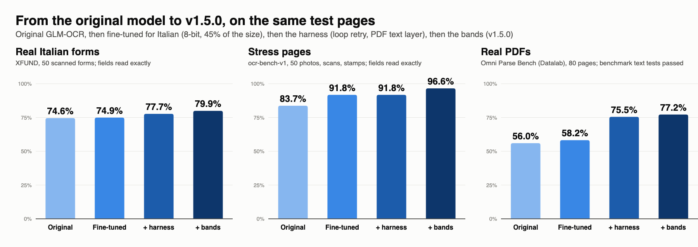
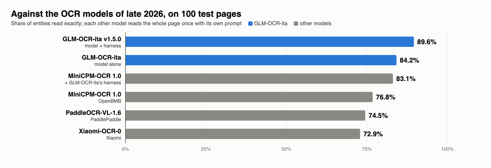

# GLM-OCR-ita

**OCR for Italian documents on a Mac.** [GLM-OCR](https://huggingface.co/zai-org/GLM-OCR) fine-tuned for Italian, compressed to 8 bits, run locally on Apple Silicon with MLX. Born-digital PDFs are read from their own text layer, and the model reads only the pages that need it.



The whole story in six pages: [overview (English)](docs/overview-v1.5.0-en.pdf), [panoramica (italiano)](docs/overview-v1.5.0-it.pdf).

- **Better than the original** on real Italian forms, on real forms in four other European languages, and on real PDFs, at **45% of the size** (1.2 GB instead of 2.7) and a third less memory.
- **Measured the hard way.** Every test read is decided before it runs, in [`docs/LEDGER.md`](docs/LEDGER.md), with paired 95% intervals, and every number below is recomputed from the raw outputs by `pytest`. Losses are reported next to gains.
- **Weights:** [`fabriziosalmi/GLM-OCR-ita-mlx-8bit`](https://huggingface.co/fabriziosalmi/GLM-OCR-ita-mlx-8bit) on Hugging Face. A GGUF of the same fine-tuned weights, for llama.cpp on Linux, Windows and in Docker: [`fabriziosalmi/GLM-OCR-ita-GGUF`](https://huggingface.co/fabriziosalmi/GLM-OCR-ita-GGUF), measured on its own and not shown equivalent ([`docs/HARNESS.md`](docs/HARNESS.md)). **Current release: v1.5.0** ([`CHANGELOG.md`](CHANGELOG.md)).

## Results

### From the original model to v1.5.0

The same test pages read at each step (MLX, M4 16 GB; [`docs/RESULTS.md`](docs/RESULTS.md#release-v150)). The harness is the loop retry and, for PDFs, the text layer; the bands are v1.5.0's.

| Test set | Original | Fine-tuned alone | + harness | **+ bands (v1.5.0)** | Bands against the harness [95% CI] |
|---|---|---|---|---|---|
| XFUND, 50 real Italian forms | 74.6% | 74.9% | 77.7% | **79.9%** | +2.2 [+0.9, +4.0] |
| ocr-bench-v1, 50 stress pages | 83.7% | 91.8% | 91.8% | **96.6%** | +4.8 [+3.1, +6.6] |
| Omni Parse Bench, 80 real PDF pages | 56.0% | 58.2% | 75.5% | **77.2%** | +3.1 [+0.0, +6.9], not worse |
| 200 unseen letters, Italian and English | - | - | 92.4% | **96.1%** | +3.7 [+2.7, +4.8] |

No page lost to the bands on any set; they add about 20% to the time of a page.

<sub>Limits: ocr-bench and the letters are this project's own sets, built with the cases the release was improved on; XFUND and Omni Parse Bench are not. The letters were never read by the original model. On Omni Parse Bench, 29 of the 80 pages are read from their PDF text layer, which the bands do not touch.</sub>

### Against other OCR models



| 100 test pages, entities read exactly | All | XFUND forms (34) | ocr-bench (33) | Letters (33) |
|---|---|---|---|---|
| **GLM-OCR-ita v1.5.0** | **89.6%** | **80.2%** | **95.3%** | **98.0%** |
| GLM-OCR-ita, model alone | 84.2% | 74.4% | 90.9% | 92.1% |
| MiniCPM-OCR 1.0 with GLM-OCR-ita's harness | 83.1% | 78.0% | 81.4% | 93.1% |
| MiniCPM-OCR 1.0 | 76.8% | 76.4% | 75.4% | 78.9% |
| PaddleOCR-VL-1.6 | 74.5% | 66.8% | 69.3% | 92.1% |
| Xiaomi-OCR-0 | 72.9% | 71.6% | 81.9% | 65.2% |

On the 100 pages MiniCPM-OCR, PaddleOCR-VL and Xiaomi-OCR-0 are each behind v1.5.0 and behind the fine-tuned model alone, with 95% intervals that exclude zero. With the same harness, MiniCPM-OCR stays 6.5 points behind v1.5.0 (-6.5 [-9.9, -3.3]) and ties the model alone. On the XFUND forms, the neutral set, MiniCPM-OCR is not told apart from either. Details in [`docs/RESULTS.md`](docs/RESULTS.md#against-other-ocr-models).

<sub>Limits: each other model read the whole page once, with its own plain-text prompt and no retry, on llama.cpp; PaddleOCR-VL and MiniCPM-OCR are made to read the regions a layout detector cuts, and their own pipelines were not run. Xiaomi-OCR-0 was read from a community GGUF, after its transformers run on a Mac GPU returned NaN on 29 pages. ocr-bench and the letters are this project's own sets: on the letters the other models leave out letterheads and footers, the failure the bands were made for. Times are not compared.</sub>

### Against the original model, every test set

Against the original model (`zai-org/GLM-OCR`, bf16), same pages, paired difference with a 95% bootstrap interval over pages. Test sets only. M4, 16 GB.

| Test set | Pages | Original | **GLM-OCR-ita** | Difference [95% CI] |
|---|---|---|---|---|
| XFUND, real Italian forms (scanned) | 50 | 74.6% | **77.7%** | **+3.1 [+1.3, +5.9]** |
| XFUND, real forms in German / Spanish / French / Portuguese | 4 × 50 | 84.8 / 81.2 / 73.2 / 81.1% | **87.3 / 85.0 / 77.2 / 84.3%** | **+2.5 / +3.8 / +4.0 / +3.2**, each better |
| Omni Parse Bench, 80 real PDF pages (text tests passed) | 80 | 56.0% | **62.5%** | **+6.9 [+2.2, +12.4]** |
| same, with the PDF text layer (`glmocr infer file.pdf`) | 80 | 56.0% | **76.1%** | **+19.1 [+11.1, +28.0]** |
| Synthetic Italian business documents, unseen renderer | 95 | 88.7% | **92.4%** | **+3.7 [+2.4, +5.1]** |
| Synthetic English business documents, same renderer | 25 | 86.8% | **93.9%** | **+7.1 [+4.1, +10.5]** |
| DocAtlas, 40 real Italian documents, clean / scanned | 40 | 98.4 / 98.4% | 98.3 / 98.1% | -0.1 / -0.3, not worse |
| SROIE, real scanned receipts (English) | 100 | 92.0% | 92.0% | +0.0 [-1.2, +1.5], not worse |
| OmniDocBench, **Chinese** pages read whole (edit distance x100, lower is better) | 45 | 14.8 | 19.7 | **-4.8 [-10.6, -0.9], worse** |
| OmniDocBench, 200 pages read by regions (`--regions`): overall, formulas by edit distance | 200 | 93.8 | 93.7 | -0.1; text not worse on English or Chinese |
| ocr-bench-v1, synthetic stress pages (camera captures, degraded scans, stamps), Italian and English | 50 | 83.7% | **91.8%** | **+8.1 [+4.2, +13.6]** |

Scores are the share of entities found exactly (amounts, dates, tax codes, IBAN, VAT numbers, PEC addresses; on XFUND its annotated fields), or the benchmark's own scorer where it has one. The synthetic and SROIE rows were read before the loop retry existed (v1.0.0, same weights); the retry changes only pages that loop. Size 1184 MB against 2651, peak memory 2.10 GB against 3.16, 72 generated tokens/s against 65. Every table, the per-type and per-level breakdowns and the full history are in [`docs/RESULTS.md`](docs/RESULTS.md).

## Quick start

Python 3.12 on Apple Silicon.

```bash
git clone https://github.com/fabriziosalmi/glm-ocr-ita && cd glm-ocr-ita
python3.12 -m venv .venv && .venv/bin/pip install -r requirements.lock -e .
source .venv/bin/activate

glmocr infer page.png      # downloads the weights (1.2 GB) on first use
glmocr infer file.pdf      # text layer where it can be trusted, the model elsewhere; --mode ocr to always use the model
```

With mlx-vlm alone, use the official prompt: `Text Recognition:` right after the image, nothing else in the assistant turn ([`docs/MODEL_CARD.md`](docs/MODEL_CARD.md) has the snippet).

## How it works

1. **Fine-tuning.** A rank-8 LoRA adapter on the decoder, trained on 91 synthetic Italian and English pages the original misread, fused into the weights. The training answers keep the model's own layout and fix only its words, so it learns what it missed, not a new format.
2. **Compression.** Every layer at 8 bits: the original's accuracy at 45% of its size. Four bits in the decoder silently drop blocks of small print, so the release does not use them ([`docs/RESULTS.md`](docs/RESULTS.md), "Compression study").
3. **Loops.** On comb fields (one character per box, as in tax codes) the decoder can repeat itself until it runs out of tokens. The reader stops a repetition as it starts and reads the page again with a repetition penalty of 1.1. If that second reading is still cut by a loop (a repeated clause longer than the penalty's 20-token window, or a dot leader), a third reading uses penalty 1.3 over 256 tokens (v1.4.0); a page that does not loop is read once.
4. **PDFs.** A page's own text layer is used when it passes four checks: not an invisible OCR layer, no broken font map, ink under its text, a content order that is a reading order. Otherwise the page goes to the model. The idea and the checks come from [Indra OCR](https://github.com/datalab-to/indra) by Datalab (Apache-2.0, see [`NOTICE`](NOTICE)).
5. **Regions (optional).** `--regions` reads a page after GLM-OCR's own pipeline: the layout detector of its [SDK](https://github.com/zai-org/glm-ocr) (Apache-2.0, in a separate PyTorch environment) finds the regions, each is read with the prompt of its kind, and the SDK's formatter assembles them. On OmniDocBench it lifts the overall score from 64.1 to 93.7 (tables, newspapers, Chinese pages); on real Italian forms it reads less than the whole page (-5.7), so it is not the default ([`docs/HARNESS.md`](docs/HARNESS.md) has the setup).

6. **Bands.** After the whole page, its top 16% and bottom 14% are read on their own and the lines the whole page missed are put in: letterheads and closing lines under blank space. +3.7 points of entity recall on 200 unseen letters, no page worse, for 20% more time; `--no-bands` turns it off. No band is read on a page that an orientation classifier (PP-LCNet, PaddlePaddle, in numpy) is sure is turned.

## Limits

- **Chinese, read whole, is worse** than with the original (above); read with `--regions` it is not worse.
- **Not faster per page** than the original: generation is faster, reading the image costs the same.
- **Real Italian documents measured:** forms, 40 DocAtlas documents, Gazzetta Ufficiale pages (dev). Phone photographs of documents only through MDPBench's Italian pages, read by the release and not yet against the original; invoices are not measured yet.
- **Large amounts on dense pages.** On 10 adversarial synthetic pages, amounts of tens of millions are sometimes written "29.467,745,94" (-5.3 [-11.3, -0.7]). On the Gazzetta's real amounts of a million or more it does better than the original.
- **Pages rotated by 90 degrees** are unreadable, as for the original: straighten them first. The orientation classifier only keeps the bands off them.
- **Bands with the GGUF:** they run, they are not measured there.
- **PDF text layer:** text drawn as paths or inside images is not in a layer, so it is lost on a page read from its layer.

## Documentation

| | |
|---|---|
| [`docs/RESULTS.md`](docs/RESULTS.md) | Every measurement, release by release: tables, breakdowns, compression study, reproducibility, failure modes |
| [`docs/LEDGER.md`](docs/LEDGER.md) | Every test-set read, with its question and threshold written before the read |
| [`docs/ROADMAP.md`](docs/ROADMAP.md) | Goals, rules, what was tried and what failed, including fine-tuning runs that were not released |
| [`docs/HARNESS.md`](docs/HARNESS.md) | The `glmocr` command: running, rebuilding the release, measuring, memory fences, repository layout |
| [`docs/MODEL_CARD.md`](docs/MODEL_CARD.md) | The card published with the weights |
| [`docs/DATASETS.md`](docs/DATASETS.md), [`docs/EXTERNAL.md`](docs/EXTERNAL.md) | The commissioned page sets; third-party data and its terms |

## License and attribution

Code, page-set generators and results: MIT ([`LICENSE`](LICENSE)). The weights are a derivative of GLM-OCR by Z.ai (`zai-org/GLM-OCR`, MIT) and keep its license; if you use them, cite the GLM-OCR technical report (arXiv 2603.10910). The PDF text-layer checks in `glmocr/pdf.py` are adapted from Indra OCR by Datalab (Apache-2.0; [`NOTICE`](NOTICE), `licenses/`). The region mode runs GLM-OCR's SDK by Z.ai (Apache-2.0), not included. Benchmarks used for evaluation only: XFUND (CC BY-NC-SA 4.0), Omni Parse Bench by Datalab (scorer Apache-2.0, tests CC BY 4.0), OmniDocBench (Apache-2.0), SROIE, DocAtlas (CC BY 4.0).
